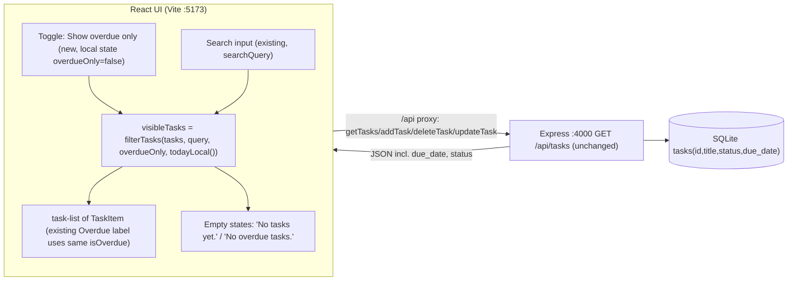

# Architecture: EPMCDMETST-73342 (Overdue quick filter)

Status: APPROVED (Phase 2 gate, human approval "Approved, proceed to Phase 3", 2026-11-23). Not committed.
Inputs: docs/EPMCDMETST-73342/requirements.md (APPROVED v2). Proposal authored by step2-architecture; written to disk by the orchestrator after the user approved with "use your recommendations".
Decisions applied: (1) extract the combined predicate into a tested helper in `frontend/src/dates.js`; (2) filter on and search matches nothing shows "No overdue tasks."; (3) the toggle is a native checkbox in the `search-form` block, below the search input.

## 1. Summary
The change is frontend-only. There is no schema change, no API change and no backend change. `App.jsx` gets one boolean state, a toggle control and a combined predicate. The predicate reuses the existing `isOverdue` and `todayLocal` from `frontend/src/dates.js`.

## 2. Component and data flow



```mermaid
sequenceDiagram
  participant U as User
  participant A as App.jsx
  participant API as GET /api/tasks
  U->>A: load page
  A->>API: getTasks
  API-->>A: all tasks (due_date may be null)
  U->>A: toggle overdue only
  A->>A: setOverdueOnly(true), re-render, no network call
  A-->>U: only rows where isOverdue(...) is true
  U->>A: add or delete a task
  A->>API: POST or DELETE, then load()
  A-->>U: list refreshed; overdueOnly and searchQuery preserved
```

## 3. Components and responsibilities
- **DB layer** (`backend/src/db.js`, `migrations.js`): unchanged.
- **API** (`backend/src/server.js`): unchanged. `GET /api/tasks` already returns `id, title, status, due_date` ordered by id DESC. It takes no query parameters, and none are added.
- **`frontend/src/dates.js`**: `isOverdue` and `todayLocal` stay as the single definition of overdue. Add a small pure helper `filterTasks(tasks, query, overdueOnly, today)` (design-review R4/L1). Contract: signature exactly as shown; lowercases the query with no trim (same as today's `searchQuery.toLowerCase()`); keeps the guard `!task || typeof task !== 'object' || task.id == null || typeof task.title !== 'string'` verbatim; applies `isOverdue(due_date, status, today)` only when `overdueOnly` is true; returns a new array and does not mutate its input. Update the file's header comment so it no longer says date helpers only.
- **`frontend/src/App.jsx`**: add `const [overdueOnly, setOverdueOnly] = useState(false)`. Render a labeled native checkbox "Show overdue only" in the `search-form` block, below the search input, with an `id`/`htmlFor` pair like the existing search label. A native checkbox is keyboard-operable and exposes its state to assistive tech. `visibleTasks` calls `filterTasks`.
- **`TaskItem`**: unchanged. Its Overdue label and the filter share `isOverdue`, so they cannot disagree.
- **`styles.css`** (R1/M1): a scoped override is required because `.search-form input` sets `width:100%` and padding on every input: `.search-form input[type='checkbox'] { width:auto; padding:0 }`, plus layout for the label. Add a manual visual check to the plan.

## 4. UI behavior
- Default off; not persisted, so it resets on reload. No count on the toggle.
- Empty state: "No tasks yet." keeps its current condition (`hasLoadedTasks && tasks.length === 0`). New: when `overdueOnly` is on, `hasLoadedTasks` is true, `tasks.length > 0` and `visibleTasks.length === 0`, show `<p className="empty" role="status">No overdue tasks.</p>` (role="status" per design-review L3). This covers a search that matches nothing while the filter is on. The two messages are mutually exclusive. With the filter off, behavior is unchanged: a search with no match shows no message today, and that stays.
- Add, delete and edit call `load()`, which only replaces `tasks`. `overdueOnly` and `searchQuery` live in `App`, so they survive.
- A task added with a past due date while the filter is on appears after the reload.
- Done, today-due and null-due tasks are hidden when the filter is on, per `isOverdue`.
- `todayLocal()` is evaluated on each render, like the existing label.

## 5. Schema migration statement
None. `due_date TEXT` already exists via the idempotent `migrate()` in `migrations.js` (`PRAGMA table_info` check, `ALTER TABLE ... ADD COLUMN`, duplicate-column guard). No `ALTER`, `DROP` or data rewrite is added. Rows with `due_date = NULL` stay valid and are never overdue.

## 6. API contracts (unchanged)
- `GET /api/tasks`: 200, array of `{id,title,status,due_date}`.
- `POST /api/tasks`: 201, or 400 for title, status or due_date validation errors.
- `PATCH /api/tasks/:id`: 200, 400 (`VALIDATION_ERROR`), 404, 413 (`PAYLOAD_TOO_LARGE`) or 500 (`INTERNAL_ERROR`).
- `DELETE /api/tasks/:id`: 204 or 404.
- `GET /api/health`: 200.

## 7. Test architecture (AC4)
No tests were run for this document, so no counts are claimed.
- **Frontend unit** (`npm run test:frontend`, `frontend/test/dates.test.js` style): cover `filterTasks` with filter on/off, combination with search, done, null due date, the today boundary, and a malformed row.
- **BDD/Playwright** (R2/R3): new file `tests/bdd/features/overdue-filter.feature` (not appended to `due-date.feature`). Scenarios: toggle on shows only overdue tasks; toggle off restores all; empty state "No overdue tasks."; filter plus search; add (with a past due date) and delete while filtered. New steps required: toggle on/off; seed a labelled task with a status and a due-date offset; add via the UI with a due date N days ago; assert a row is present or absent by title; assert the empty-state text. `row` and `seed` are module-private in `due-date.steps.js`, so export them or place the new steps where they are reachable. Reuse existing step texts verbatim (mocked clock, open page, "a {string} task exists with a due date {int} days ago") to avoid playwright-bdd ambiguity.
- **Scenario rules:** the empty-state scenario must seed at least one non-overdue task (an empty DB shows "No tasks yet."). Use title-scoped assertions, not "only the {string} task is listed", because stale rows may exist in the shared E2E DB. Run via `npm run test:bdd`, because `npm run test:search` skips `pretest:bdd` and `bddgen`.
- **Backend**: no new tests, since there is no backend change.
- **DB isolation:** `playwright.config.js` already sets `DB_PATH` to `tests/.tmp/e2e.db` with `reuseExistingServer: false`, and `pretest:bdd` clears `tests/.tmp`. New tests inherit this. Nothing may use the default `backend/tasks.db`.

## 8. Brownfield and risk notes
- Existing view, add, delete and title-edit paths are not modified. AC3 means preserving the existing status behavior only; there is no new complete control.
- Risk: duplicating the overdue logic would let the filter and label drift. Mitigation: only `isOverdue` defines overdue.
- Risk: the empty-state condition interacts with search and load state. Mitigation: the `hasLoadedTasks` gate and mutually exclusive conditions.
- Risk: the BDD helper `tests/bdd/support/dates.js` is separate from `frontend/src/dates.js`. Keep test dates relative to the mocked clock.
- Tracked files `tasks.db`, `tasks.db-shm` and `tasks.db-wal` must stay unmodified. Do not stage `docs/codemie/analytics/*.json` or `.claude/hooks/subagent-audit.log`.

## 9. Design review follow-up
The files the Phase 2 author did not read (`frontend/test/dates.test.js`, `frontend/src/api.js`, `styles.css`, `backend/test/*`, `validation.js`, `fixtures.js`) were reviewed in Phase 3. See docs/EPMCDMETST-73342/design-review.md; R1-R5 are applied above. A newly added task with no due date or a future date disappears while the filter is on; this is accepted (L4), with no hint.
