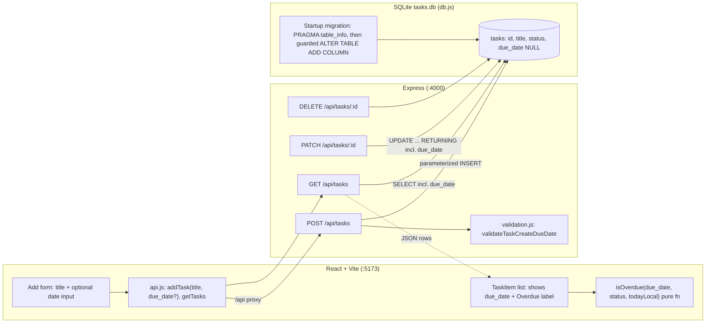

# Architecture: US-101 Optional Task Due Date (Brownfield)

- **Inputs:** `docs/requirements.md`, `docs/requirements-local.md` (FR/NFR IDs below cite the local file), `docs/user-story.md`
- **Status:** Approved by human reviewer
- **Scope:** `task-manager-app/` (Express + better-sqlite3 backend, React + Vite frontend)

## 1. Decisions

| # | Topic | Decision |
|---|---|---|
| D1 | `PATCH` response | Includes `due_date` (FR-8). `requirements.md` said `PATCH` is unchanged; the local file wins so a title edit never hides the date. The three `deepEqual({id,title,status})` assertions in `tasks.patch.test.js` (lines 64, 185, 203) change to include `due_date: null`. |
| D2 | POST 400 text | `due_date must be a valid date in YYYY-MM-DD format` (legacy `{ error: string }` shape). |
| D3 | Empty due date in UI | Show nothing. |
| D4 | Date parsing | No `new Date(string)`. Validation is independent of server timezone. |
| D5 | Accessibility | Labelled date input, visible and screen-reader-readable "Overdue" label, input cleared after successful add. |
| D6 | Also adopted | `POST` validation errors in the existing error area (FR-15), parameterized queries (NFR-3), single-PRAGMA migration check (NFR-6). |
| D7 | Invalid-value tests | Union of both requirement files' examples. |
| D8 | Test tooling | File `backend/test/tasks.due-date.test.js` with a `DB_PATH` temp database; E2E via `npm run test:bdd`, plus the "done task is not overdue" case. |
| D9 | Migration testability | Extract the migration into an exported `migrate(db)` function. |
| D10 | Falsy handling | `due_date` must not copy the status validator's falsy defaulting. Only `undefined`, `null` and `""` mean no date; `0` and `false` return 400. |
| D11 | Accepted limitations | Years `0000`-`9999` accepted; overdue is computed at render time, so a tab open past midnight is stale until the next render or reload; no frontend unit-test runner (covered by `node:test` and E2E). |

## 2. Component and Data Flow



## 3. SQLite Migration (`backend/src/db.js`, ST-1; FR-1 to FR-3)

The change is additive and runs once at module load, after the existing `CREATE TABLE IF NOT EXISTS`, which stays untouched. A fresh database is created without `due_date` and then upgraded by the same code path.

```js
function migrate(db) {
  const cols = db.prepare('PRAGMA table_info(tasks)').all();
  if (!cols.some((c) => c.name === 'due_date')) {
    db.exec('ALTER TABLE tasks ADD COLUMN due_date TEXT');
  }
}
```

- `migrate(db)` is exported so tests can run it directly against a legacy-schema database.
- **No data loss (NFR-2):** no DROP, table rebuild or DELETE. SQLite fills `due_date` with NULL for existing rows, including legacy rows with odd statuses such as `blocked`.
- **Idempotent:** the PRAGMA guard makes a second start a no-op.
- **No CHECK constraint:** `ALTER` cannot add one; the API layer is the authority, as it already is for `status`.
- **Atomicity:** a single `ALTER` is atomic. Optionally wrap check and alter in `db.transaction` as insurance against two processes starting at once.

## 4. API Contracts (`server.js`, `validation.js`, ST-2; FR-4 to FR-9)

### Validator `validateTaskCreateDueDate(v)` returns `{ value, error }`
1. `undefined`, `null` or `""` returns `{ value: null }` (explicit check, not falsy).
2. A non-string (number, boolean, object, array) is an error.
3. The string must match `^(\d{4})-(\d{2})-(\d{2})$` exactly. This rejects padding, timestamps and `2025-2-1`.
4. Year, month and day are parsed as integers and checked against a month-length table with the leap-year rule. No `new Date(string)`.
5. Year `0000` is syntactically valid and accepted; the leap-year rule applies to year 0 as well.

### Routes

| Route | Request | Success | Errors |
|---|---|---|---|
| `POST /api/tasks` | `{title, status?, due_date?}` | `201 {id, title, status, due_date: "YYYY-MM-DD" or null}` | Existing 400s unchanged. New: `400 {error:"due_date must be a valid date in YYYY-MM-DD format"}` |
| `GET /api/tasks` | none | `200 [{id,title,status,due_date}]`, ordered `id DESC` | none new |
| `PATCH /api/tasks/:id` | `{title?, status?}` only | `200 {id,title,status,due_date}` | A `due_date` key still returns `400 {error:{code:"VALIDATION_ERROR",message,details:[{field:"due_date",issue:"unknown field"}]}}`. No other change. |
| `DELETE /api/tasks/:id` | none | `204` | `404 {error:"task not found"}`, unchanged |
| `GET /api/health` | none | `200 {status:"ok"}`, unchanged | none |

- **POST validation order:** title, title length, status, `due_date`, then INSERT. An invalid date never inserts a row.
- **SQL:** `INSERT INTO tasks (title, status, due_date) VALUES (?, ?, ?)` and `SELECT id, title, status, due_date ...`. `PATCH` changes only its `RETURNING` clause. All values are parameterized (NFR-3).
- **Error shapes:** `POST` keeps the legacy `{error:string}` shape and `PATCH` keeps the envelope, so the existing "legacy shapes" regression test continues to hold.
- **GET and AC3:** `GET` has no input to validate and only returns `due_date`.

## 5. React UI Changes (ST-3; FR-10 to FR-15)

### `frontend/src/api.js`
- `addTask(title, dueDate)` builds the body as `{title}` and adds `due_date` only when `dueDate` is a non-empty string.
- `errorMessage` already surfaces the legacy string, so FR-15 needs no change.

### New `frontend/src/dates.js` (pure helpers)
- `todayLocal()` returns `YYYY-MM-DD` from `getFullYear()`, `getMonth()+1` and `getDate()`, zero-padded. It does not use `toISOString()`, which returns the UTC date.
- `isOverdue(dueDate, status, today)` returns `!!dueDate && status !== 'done' && dueDate < today`. String comparison on fixed-width ISO dates; a task due today is not overdue. `today` is a parameter for testability.

### `frontend/src/App.jsx`
- New `dueDate` state.
- Form: `<label htmlFor="task-due-date">Due date (optional)</label>` and `<input id="task-due-date" type="date">`, no min or max.
- `handleAdd` passes the date to `addTask` and clears it after success.
- `TaskItem` renders `<time dateTime={due_date} className="due-date">{due_date}</time>` only when a date exists (raw ISO).
- When `isOverdue(...)` is true, the `<li>` gets `className="overdue"` and the row includes `<span className="overdue-label">Overdue</span>` (visible text, read by screen readers).
- The existing rule `li > span:first-child { flex: 1 }` relies on the title being the first span, so the date and label are added after the title, next to the status.
- Search, inline edit, delete and the title clamp are untouched.

### `frontend/src/styles.css`
```css
.due-date { font-size: .75rem; color: #555; }
.task-list li.overdue { background: #fdecea; border-left: 4px solid #b00020; }
.overdue-label { color: #b00020; font-weight: 600; font-size: .75rem; text-transform: uppercase; }
```
`#b00020` on `#fdecea` is about 6:1 contrast and reuses the existing error colour. Overdue is signalled by text, colour and border, so colour is not the only cue (NFR-4).

## 6. Testing (ST-4; FR-16, FR-17)

- **`backend/test/tasks.due-date.test.js`** (`node --test`, `DB_PATH` temp database):
  - valid dates including `2024-02-29`; omitted, `null` and `""`;
  - invalid values: `2025-02-30`, `2025-2-1`, a timestamp, padded whitespace, number, boolean, array, object. Each returns 400 with the exact message and inserts no row;
  - `GET` and `PATCH` responses include `due_date`; `PATCH` with `due_date` is still rejected as an unknown field;
  - migration: build a legacy-schema database, insert rows, call `migrate(db)` twice. Rows survive, `due_date` is NULL, and the second call does not fail.
- **Existing tests:** update the three `deepEqual` assertions in `tasks.patch.test.js` (D1). Before implementation, also check `tasks.enhancements.test.js` and `tasks.post-status.test.js` for exact response-shape assertions (not yet inspected).
- **Frontend unit:** `isOverdue` and `todayLocal` are plain ESM, tested with `node:test`.
- **E2E (`npm run test:bdd`):** a new `.feature` and step definitions covering date display, overdue past-due, `done` not overdue, due today, future, no date, and an add/delete regression. Dates are created relative to the real date, through the API where possible. The existing `tests/` layout and Playwright config have not been inspected yet.

## 7. Traceability

| Item | Architecture sections |
|---|---|
| AC1 | 5 (form, `api.js`) |
| AC2 | 3 (migration), 6 (migration test) |
| AC3 | 4 (validator, routes) |
| AC4 | 5 (`dates.js`, `App.jsx`, `styles.css`) |
| ST-1 / FR-1 to FR-3 | 3 |
| ST-2 / FR-4 to FR-9 | 4 |
| ST-3 / FR-10 to FR-15 | 5 |
| ST-4 / FR-16, FR-17 | 6 |
| NFR-1 to NFR-8 | 3, 4, 5, 6, 8 |

## 8. Risks and Limitations

1. **Overdue and midnight:** computed at render time, so a tab open past midnight is stale until the next render or reload. Accepted.
2. **Timezone differences:** overdue uses the browser's local date, so users in different timezones can disagree. This is the stated requirement; no server logic is added.
3. **Concurrent migration:** two backend processes starting together could hit a duplicate-column error. Low risk for a single-process dev app; the optional transaction and re-check reduce it.
4. **Legacy statuses:** a row with status `blocked` is not `done`, so it can be overdue. Consistent with FR-13.
5. **Past dates:** accepted at creation, so a task can be overdue the moment it is created. By design.
6. **Frontend tests:** no unit-test runner exists; overdue logic is covered by `node:test` and E2E only.
7. **Windows (NFR-7):** all commands are PowerShell-safe (`npm run test:bdd`, `node --test backend/test`); `DB_PATH` temp directories work on Windows.

## 9. Out of Scope

- Editing or clearing a due date after creation.
- Sorting or filtering by due date.
- Locale-formatted dates.
- Time-of-day or timezone-aware deadlines.
